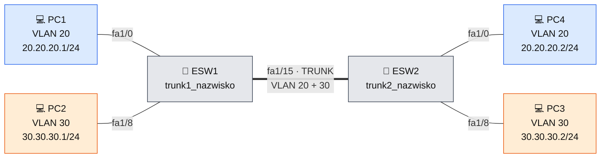

<div align="center">
# 🧪 GNS3 – ostatnia kartkówka
 
**VLAN-y i trunk na dwóch switchach EtherSwitch – krok po kroku**
 


 
</div>
---
 
> [!IMPORTANT]
> Wszędzie, gdzie w komendach jest `nazwisko`, wpisz **swoje nazwisko** – bez polskich znaków (np. `kupujacy_nowak`, a nie `kupujący_nowak`).
 
## 🎯 Cel zadania
 
Skonfiguruj **switch 1** i **switch 2** tak, żeby komputery z tego samego VLAN-u komunikowały się ze sobą przez trunk.
 
| # | Wymaganie | Gdzie |
|:-:|-----------|:-----:|
| 1 | Zmień nazwy hostów na `trunk1_nazwisko` i `trunk2_nazwisko` | [Krok 1](#-1-zmiana-nazwy-hosta) |
| 2 | Porty `fa1/0 - 14` ustaw w trybie **access** | [Krok 2](#-2-tryb-access-na-portach) |
| 3 | Port `fa1/15` ustaw w trybie **trunk** | [Krok 3](#-3-port-trunk) |
| 4 | Utwórz VLAN 20 `sprzedawcy_nazwisko` (porty `fa1/0 - 7`) i VLAN 30 `kupujacy_nazwisko` (porty `fa1/8 - 14`) | [Krok 4](#-4-vlan-y-i-przypisanie-portów) |
| 5 | Podłącz komputery z adresacją: VLAN 20 → `20.20.20.0/24`, VLAN 30 → `30.30.30.0/24` | [Krok 5](#-5-adresacja-komputerów) |
| 6 | Na trunku włącz komunikację dla VLAN 20 i VLAN 30 | [Krok 6](#-6-trunk-dla-vlan-20-i-30) |
| 7 | Opisz porty trunk w formacie `trunk_` + nazwa switcha | [Krok 7](#-7-opis-portu-trunk) |
| 8 | Potwierdź pingiem komunikację w VLAN-ach i między switchami | [Krok 8](#-8-test-komunikacji) |
| 9 | Utwórz plik `trunk_nazwisko.txt` z `show running-config` i pingami | [Krok 9](#-9-zapis-konfiguracji-do-pliku) |
 
> [!TIP]
> Szukasz samych komend do skopiowania? Przejdź do [szybkiej ściągi](#-szybka-ściąga). Coś nie działa? Zajrzyj do [rozwiązywania problemów](#-co-jeśli-nie-działa).
 
---
 
## 🧭 Topologia i plan adresacji
 
Do konfiguracji potrzebujemy **2 switchy** (ESW1 i ESW2) oraz **4 komputerów** (VPCS). Na każdym switchu stoi jeden komputer w VLAN 20 i jeden w VLAN 30. Switche łączy port `fa1/15` skonfigurowany jako trunk.
 

 
🔵 VLAN 20 – sprzedawcy  ·  🟠 VLAN 30 – kupujący  ·  gruba linia = trunk
 
### Mapa portów (tak samo na obu switchach)
 
| Porty | Tryb | VLAN |
|-------|:----:|------|
| `fa1/0` – `fa1/7` | access | **20** `sprzedawcy_nazwisko` |
| `fa1/8` – `fa1/14` | access | **30** `kupujacy_nazwisko` |
| `fa1/15` | **trunk** | **20** i **30** |
 
### Adresacja komputerów
 
| Komputer | Switch | Port | VLAN | Adres IP |
|:--------:|:------:|:----:|:----:|----------|
| **PC1** | ESW1 | `fa1/0` | 20 | `20.20.20.1/24` |
| **PC2** | ESW1 | `fa1/8` | 30 | `30.30.30.1/24` |
| **PC3** | ESW2 | `fa1/8` | 30 | `30.30.30.2/24` |
| **PC4** | ESW2 | `fa1/0` | 20 | `20.20.20.2/24` |
 
---
 
## 📝 1. Zmiana nazwy hosta
 
📍 Wykonaj na: **ESW1** i **ESW2** (każdy switch ma inną nazwę)
 
Wejdź do konsoli switcha i przejdź do trybu konfiguracji (`conf te` to skrót od `configure terminal`).
 
**ESW1:**
 
```
configure terminal
hostname trunk1_nazwisko
exit
```
 
**ESW2:**
 
```
configure terminal
hostname trunk2_nazwisko
exit
```
 
Znak zachęty zmieni się na nową nazwę, np. `trunk1_nazwisko#`. ✅
 
---
 
## 🔌 2. Tryb access na portach
 
📍 Wykonaj na: **ESW1** i **ESW2**
 
Zakres portów `fa1/0 - 14` ustawiamy w trybie **access**:
 
```
configure terminal
interface range fastEthernet 1/0 - 14
 switchport mode access
exit
```
 
> [!NOTE]
> Zakres zapisujemy ze spacjami wokół myślnika: `1/0 - 14`.
 
---
 
## 🔗 3. Port trunk
 
📍 Wykonaj na: **ESW1** i **ESW2**
 
Port `fa1/15` łączy oba switche, więc ustawiamy go w trybie **trunk**:
 
```
configure terminal
interface fastEthernet 1/15
 switchport mode trunk
exit
```
 
> [!NOTE]
> Mogą pojawić się jakieś komunikaty – zwykle nie przeszkadzają w konfiguracji.
 
---
 
## 🔖 4. VLAN-y i przypisanie portów
 
📍 Wykonaj na: **ESW1** i **ESW2**
 
### Utworzenie VLAN-ów
 
VLAN-y tworzymy w bazie danych VLAN. Robimy to w trybie `#` (nie w `(config)#`), więc jeśli jesteś w trybie konfiguracji, wpisz najpierw `end`.
 
```
vlan database
vlan 20 name sprzedawcy_nazwisko
vlan 30 name kupujacy_nazwisko
exit
```
 
> [!WARNING]
> VLAN-y zapisują się dopiero po wyjściu z bazy komendą `exit` (albo `apply`). Bez tego VLAN-ów może nie być na liście.
 
### Przypisanie portów do VLAN-ów
 
| VLAN | Nazwa | Porty |
|:----:|-------|-------|
| **20** | `sprzedawcy_nazwisko` | `fa1/0 - 7` |
| **30** | `kupujacy_nazwisko` | `fa1/8 - 14` |
 
Porty były już ustawione w trybie access w kroku 2, więc teraz tylko przypisujemy je do VLAN-ów:
 
```
configure terminal
interface range fastEthernet 1/0 - 7
 switchport access vlan 20
interface range fastEthernet 1/8 - 14
 switchport access vlan 30
exit
```
 
Sprawdź, czy oba VLAN-y są widoczne i mają przypisane porty:
 
```
show vlan-switch
```
 
---
 
## 🔢 5. Adresacja komputerów
 
📍 Wykonaj w konsolach komputerów **PC1 – PC4** (VPCS)
 
Każdy VLAN to osobna sieć: VLAN 20 → `20.20.20.0/24`, VLAN 30 → `30.30.30.0/24`. Komputerom nadajemy adresy z tych sieci:
 
| Komputer | Switch / VLAN | Komenda |
|:--------:|:-------------:|---------|
| **PC1** | ESW1 / 20 | `ip 20.20.20.1/24` |
| **PC2** | ESW1 / 30 | `ip 30.30.30.1/24` |
| **PC3** | ESW2 / 30 | `ip 30.30.30.2/24` |
| **PC4** | ESW2 / 20 | `ip 20.20.20.2/24` |
 
Ustawienia możesz sprawdzić na danym komputerze komendą:
 
```
show ip
```
 
> [!NOTE]
> Adres `.0` to adres **sieci**, więc nie można go nadać komputerowi. Dlatego komputery dostają `.1` i `.2`.
 
> [!TIP]
> Komenda `save` zapisuje ustawienia VPCS, żeby nie zniknęły po restarcie projektu.
 
---
 
## 🚦 6. Trunk dla VLAN 20 i 30
 
📍 Wykonaj na: **ESW1** i **ESW2**
 
Na porcie trunk dopuszczamy ruch z obu VLAN-ów:
 
```
configure terminal
interface fastEthernet 1/15
 switchport trunk allowed vlan add 20
 switchport trunk allowed vlan add 30
exit
```
 
> [!IMPORTANT]
> Całą konfigurację trzeba wykonać **na obu switchach**. Jeśli zrobisz ją tylko na jednym, komunikacja między switchami nie zadziała.
 
> [!TIP]
> Jeśli komenda z `add` zwróci błąd, użyj zamiast niej: `switchport trunk allowed vlan 20,30`
 
---
 
## 📌 7. Opis portu trunk
 
📍 Wykonaj na: **ESW1** i **ESW2**
 
Port trunk opisujemy w formacie `trunk_` + nazwa switcha.
 
**ESW1:**
 
```
configure terminal
interface fastEthernet 1/15
 description trunk_trunk1_nazwisko
exit
```
 
**ESW2:**
 
```
configure terminal
interface fastEthernet 1/15
 description trunk_trunk2_nazwisko
exit
```
 
---
 
## 🏓 8. Test komunikacji
 
Pingujemy komputery z **tego samego VLAN-u**, które stoją na **różnych switchach** – ruch przechodzi wtedy przez trunk `fa1/15`.
 
| VLAN | Z komputera | Komenda | Oczekiwany wynik |
|:----:|:-----------:|---------|------------------|
| 20 | **PC1** | `ping 20.20.20.2` | ✅ odpowiedzi od PC4 |
| 20 | **PC4** | `ping 20.20.20.1` | ✅ odpowiedzi od PC1 |
| 30 | **PC2** | `ping 30.30.30.2` | ✅ odpowiedzi od PC3 |
| 30 | **PC3** | `ping 30.30.30.1` | ✅ odpowiedzi od PC2 |
 
**Test negatywny:** `ping 30.30.30.1` z PC1 (VLAN 20 → VLAN 30) **nie** powinien przejść. To inne sieci i inne VLAN-y.
 
> [!NOTE]
> Przy pierwszym pingu pierwsza odpowiedź może się zgubić (ARP). Kolejne powinny już przechodzić.
 
> [!TIP]
> Jeśli trzeba pokazać ping także w obrębie jednego switcha, podłącz drugi komputer w tym samym VLAN-ie do tego samego switcha (np. do `fa1/1` w VLAN 20), nadaj mu adres z tej samej sieci i spinguj go.
 
---
 
## 📄 9. Zapis konfiguracji do pliku
 
Utwórz plik `trunk_nazwisko.txt` i wklej do niego konfigurację obu switchy oraz wyniki pingów.
 
Na każdym switchu (w trybie `#`) wpisz:
 
```
terminal length 0
show running-config
```
 
Skrócona wersja ostatniej komendy to `sh run`. Wynik skopiuj z konsoli do pliku.
 
Przykładowy układ pliku:
 
```
===== ESW1 - show running-config =====
(wklej wynik)
 
===== ESW2 - show running-config =====
(wklej wynik)
 
===== PING VLAN 20: PC1 -> PC4 =====
(wklej wynik)
 
===== PING VLAN 30: PC2 -> PC3 =====
(wklej wynik)
```
 
> [!TIP]
> `terminal length 0` wyłącza stronicowanie (`--More--`), dzięki czemu cała konfiguracja wypisze się naraz i łatwo ją skopiować.
 
---
 
## 🧰 Szybka ściąga
 
Cała konfiguracja jednym blokiem (kroki 1–4 oraz 6–7). Rozwiń swój switch i skopiuj. Adresy komputerów znajdziesz w [kroku 5](#-5-adresacja-komputerów).
 
<details>
<summary><b>🔀 ESW1 – pełna konfiguracja</b></summary>
```
enable
vlan database
vlan 20 name sprzedawcy_nazwisko
vlan 30 name kupujacy_nazwisko
exit
configure terminal
hostname trunk1_nazwisko
interface range fastEthernet 1/0 - 14
 switchport mode access
interface range fastEthernet 1/0 - 7
 switchport access vlan 20
interface range fastEthernet 1/8 - 14
 switchport access vlan 30
interface fastEthernet 1/15
 description trunk_trunk1_nazwisko
 switchport mode trunk
 switchport trunk allowed vlan add 20
 switchport trunk allowed vlan add 30
exit
```
 
</details>
<details>
<summary><b>🔀 ESW2 – pełna konfiguracja</b></summary>
```
enable
vlan database
vlan 20 name sprzedawcy_nazwisko
vlan 30 name kupujacy_nazwisko
exit
configure terminal
hostname trunk2_nazwisko
interface range fastEthernet 1/0 - 14
 switchport mode access
interface range fastEthernet 1/0 - 7
 switchport access vlan 20
interface range fastEthernet 1/8 - 14
 switchport access vlan 30
interface fastEthernet 1/15
 description trunk_trunk2_nazwisko
 switchport mode trunk
 switchport trunk allowed vlan add 20
 switchport trunk allowed vlan add 30
exit
```
 
</details>
### Komendy pomocnicze
 
| Gdzie | Komenda | Do czego |
|:-----:|---------|----------|
| switch | `show vlan-switch` | lista VLAN-ów i przypisanych portów |
| switch | `show running-config` | cała konfiguracja (do pliku `.txt`) |
| komputer | `show ip` | adres IP i maska komputera |
| komputer | `ping <adres>` | test połączenia |
 
---
 
## 🆘 Co jeśli nie działa
 
| Objaw | Prawdopodobna przyczyna | Rozwiązanie |
|-------|-------------------------|-------------|
| Ping między switchami nie przechodzi | Konfiguracja zrobiona tylko na jednym switchu | Powtórz VLAN-y i trunk na drugim switchu |
| VLAN-u nie ma na liście | Brak `exit` po `vlan database` | Wejdź ponownie w `vlan database` i wyjdź komendą `exit` |
| Pierwszy ping się zgubił | Normalne zachowanie (ARP) | Wyślij ping jeszcze raz |
| Komputery z tego samego VLAN-u się nie widzą | Zły VLAN na porcie albo adresy z różnych sieci | Sprawdź `show vlan-switch` oraz `show ip` na komputerze |
| `switchport trunk allowed vlan add` zwraca błąd | Różnice w wersji IOS | Użyj `switchport trunk allowed vlan 20,30` |
| Komputer z VLAN 20 nie pinguje VLAN 30 | To poprawne zachowanie | Do komunikacji między VLAN-ami potrzebny byłby router (poza zakresem zadania) |
 
---
 
> [!CAUTION]
> To jest moja wersja notatki i mogą być w niej błędy!
