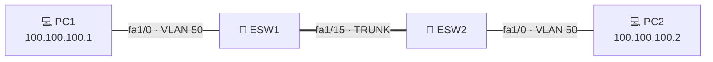

# 🌐 Eksploatacja – VLAN w GNS3

> Jak stworzyć VLAN i skonfigurować komunikację między komputerami podłączonymi do **oddzielnych EtherSwitchy**.

## 📑 Spis treści

1. [Topologia](#-topologia)
2. [Tworzenie VLAN](#-tworzenie-vlan)
3. [Przypisywanie portów do VLAN](#-przypisywanie-portów-do-vlan)
4. [Konfiguracja trunka](#-konfiguracja-trunka)
5. [Testowanie](#-testowanie)

---

## 🗺️ Topologia

Minimalna wymagana konfiguracja: **2 × VPCS**, każdy podłączony do osobnego **EtherSwitcha** (ESW1 i ESW2). Przełączniki są połączone ze sobą portem `fa1/15`.



---

## 🛠️ Tworzenie VLAN

1. Wejdź do konsoli **ESW1**.
2. Aby utworzyć VLAN, trzeba wejść do bazy danych VLAN:

   ```
   vlan database
   ```

3. Utwórz VLAN, np. o numerze 50:

   ```
   vlan 50
   ```

4. Zatwierdź zmiany i wyjdź z bazy VLAN:

   ```
   exit
   ```

> [!TIP]
> Żeby komputery się komunikowały, trzeba:
> - przypisać ich porty do VLAN 50,
> - ustawić tryb **trunk** na porcie łączącym oba przełączniki (u mnie `fa1/15`).

---

## 🔌 Przypisywanie portów do VLAN

Najpierw wejdź w tryb konfiguracji:

```
configure terminal
```

lub skrótem:

```
conf te
```

Następnie wybierz porty, które chcesz przypisać:

| Cel | Komenda |
|-----|---------|
| Zakres portów (np. 0–10) | `interface range fastEthernet 1/0 - 10` |
| Jeden port | `interface fastEthernet 1/0` |

> [!NOTE]
> W miejsce `0` wstaw numer portu, którego chcesz użyć.

Włącz tryb **access** i przypisz port do VLAN:

```
switchport mode access
switchport access vlan 50
```

✅ Gotowe – porty są w VLAN 50.

---

## 🔗 Konfiguracja trunka

Teraz ustawiamy tryb **trunk** na porcie, którym połączone są przełączniki (u mnie `fa1/15`).

```
interface fastEthernet 1/15
switchport mode trunk
```

> [!NOTE]
> Mogą pojawić się jakieś komunikaty, ale nie powinny przeszkodzić w konfiguracji.

Dodaj VLAN 50 do portu trunk:

```
switchport trunk allowed vlan add 50
```

> [!IMPORTANT]
> Całą konfigurację trzeba wykonać **także na drugim przełączniku (ESW2)** – bez tego komunikacja nie zadziała!

---

## ✅ Testowanie

Wejdź w konsolę każdego komputera i nadaj mu adres IP (podane adresy są przykładowe).

| Komputer | Komenda |
|----------|---------|
| **PC1** | `ip 100.100.100.1/24` |
| **PC2** | `ip 100.100.100.2/24` |

Następnie sprawdź połączenie pingiem:

| Z komputera | Komenda |
|-------------|---------|
| **PC1** | `ping 100.100.100.2` |
| **PC2** | `ping 100.100.100.1` |

Jeśli odpowiedzi wracają – VLAN i trunk działają poprawnie 🎉

---

> [!CAUTION]
> To jest moja wersja poradnika i mogą być w niej błędy!
